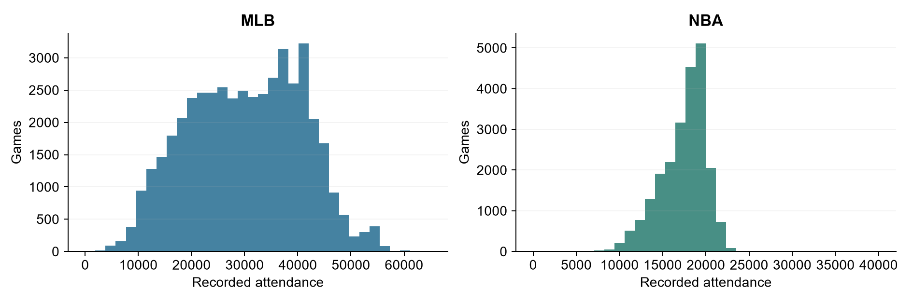
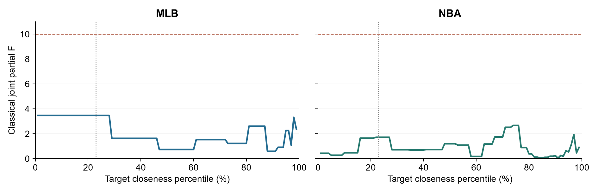
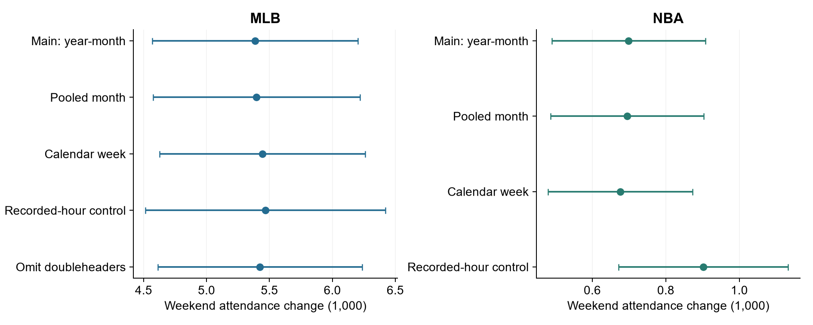
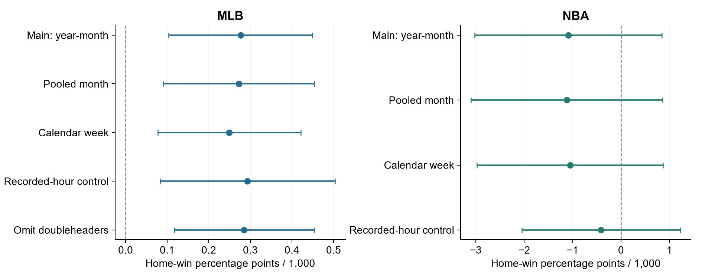

# ECON521 research progress update

Aden Diaz | November 19, 2026

## Status and provenance

The project asks whether fan attendance affects home-team outcomes. This update documents the progression from previous-game closeness to the weekend working instrument and adds preliminary game-level OLS, reduced-form and 2SLS models for MLB and NBA. All new IV interpretations are conditional on relevance, independence and exclusion. Weekend scheduling may directly affect play, so the results do not establish a causal attendance effect.

GitHub plugin access was verified; the default branch was `main`, at `51c94a98731180e5be3415892c6846a0590f0250` (November 10, 2026). A local clone matched that commit. Historical files, raw data and cached weather were preserved. The historical instrument search was audited from saved outputs, not rerun. The update adds only new scripts/results. Nothing was committed, pushed or submitted.

The broader current research scope is NBA, NFL and MLB. At the source snapshot only MLB and NBA have estimation samples. NFL provides the closeness calibration reference, with incomplete season coverage. NHL appeared in the initial aspiration but is excluded for lack of suitable data. NFL is not presented as a completed causal analysis.

## Research progression

| Stage | Evidence | Interpretation |
|---|---|---|
| Initial question and IV proposal | `git show 1b87852:README.md` (2026-10-28), Research Design | Broad initial aspiration covered four leagues. Treatment was fan attendance; proposed outcome home-team win percentage; previous-game closeness proposed as IV. Original README already acknowledged possible direct performance effects. |
| Exploratory cleaning/history | `notebooks/archive/FirstStage_exploratory.ipynb`, 15 cells, especially cells 7-13 | Archive cleans, inspects margins and prior-game histories; explicitly says no close threshold or regression is run. Not evidence of prior second-stage work. Provisional modern-era filter started 1960. |
| Canonical first-stage pipeline | Commit `49a3fff`, then `0f79f57`; `scripts/prepare_data.py`, `scripts/first_stage.py`; current `notebooks/01_first_stage.ipynb` cells 0,4,11 | Cleaning and first-stage estimation completed. `0f79f57` changed current-game analysis from provisional 1960-onward to calendar 2001–2019, aligned with available NFL calibration records; broadened percentile grid. Historical values 1.08/0.07 F in `49a3fff` README are superseded, not directly comparable to current 3.47/1.72. |
| Original closeness fails relevance screen | Current `results/first_stage/report.md`, First-stage findings; `selected_first_stage.csv` | At NFL anchor: conventional joint partial F 3.47 MLB, 1.72 NBA. No conventional joint partial F exceeds 10 across tested grid. Some clustered Wald statistics significant; degenerate-cutoff outliers are not useful instruments. |
| Initial alternative screen | Commit `020b0c7`; `results/instrument_candidates/candidate_screen_report.md` | Cross-league schedule conflicts and NBA pregame weather tested; neither ready as common IV. MLB within-two-hours conflict conventional F 12.67 but home-team-clustered Wald F 5.59; NBA weak. Report's instruction to stop before second stage is historical scope, superseded only by the authorized new extension. |
| Expanded exploratory search | Commit `51c94a9`; `expanded_candidate_report.md`; `all_candidate_inventory.csv`; expanded/robustness scripts | Calendar, rest/timing, lagged gates, NBA weather thresholds and MLB weather added. Report explicitly says no reduced form or second stage. Weekend chosen as leading candidate to evaluate for both leagues, not validated. |
| New progress update | November 19, 2026 extension | Any OLS outcome model, reduced form, 2SLS, or outcome-sensitivity analysis now produced is new exploratory work; label it so. No evidence of earlier completed stage two exists at inspected commit. |

## Closeness rationale and qualifications

The proposed attendance channel is intuitive: a close recent game may sustain fan interest, excitement and expectations for a competitive next game, altering demand before the next outcome. A separate close-prior-game indicator for each current team is interpretable; absolute margin avoids confusing winning with competitive closeness; mapping margins through a common percentile allows cross-sport scaling. The fan-engagement explanation is a plausible theoretical rationale, not an empirically established mechanism in the repository. The actual implementation uses separate immediately previous home/away team game indicators, not an aggregate season closeness statistic.

Counterevidence: first stages are weak; prior-game closeness can reflect team quality and affect fatigue, morale, confidence, injuries or strategic preparation directly. Temporal precedence is insufficient for exclusion or independence. See current `README.md` Research question/First-stage result; `results/first_stage/report.md`, last paragraph of First-stage findings. The old README at `1b87852` explicitly noted a subsequent-performance channel.

NFL anchor is **margin <=3 points** by project definition, not every football one-possession game. It is 1,103/4,808 =22.94%; MLB cutoff 1 run yields 28.25% actual close share; NBA 5 points yields 27.81%. Discreteness means shares need not equal target. NFL is calibration only, not a completed causal/outcome sample. It covers 2001–2019, missing parts of four seasons (current first-stage report names them), rather than requested 2000–2023. Broader source histories do not equal estimation samples.

## Seed-paper comparison

Source: Scott C. Ganz and Kieran Allsop, *A Mere Fan Effect on Home-Court Advantage*, Journal of Sports Economics 25(1), 30–53; copyright/online 2023, journal volume 2024, DOI 10.1177/15270025231200890. File `references/seed_paper/ganz-allsop-2023-a-mere-fan-effect-on-home-court-advantage.pdf`. Printed page = PDF page +29. All 24 PDF pages were read; key methods and result pages were also rendered.

| Dimension | Seed paper | ECON521 implementation at inspected commit / implication |
|---|---|---|
| Question | Does presence/crowd size cause NBA home-court advantage, isolating the mere effect of fans? Introduction pp.30–32 (PDF1–3). | Broad cross-sport attendance/home-team result question. Similar motivation; distinct setting and estimand. |
| Main sample | 2020–21 NBA regular season; main regression 808 games, 27 home teams: Table1 p.41 (PDF12). Data pp.34–35 (PDF5–6) removes 25 zero-attendance misreports and excludes Indiana, Miami and Sacramento home games due continued zero reporting after reopening. | MLB/NBA calendar 2001–2019 current-game first stages; positive usable attendance and prior-history requirements, with regular/playoff mixed in original sample. NFL calibration; NHL excluded. New stage-two restrictions must be documented separately. |
| Attendance measure/support | Reported fan count from basketball-reference/official summaries, scaled by 1,000 for regressions; zero attendance is substantively important. Largest crowd 8,359; most arenas well below capacity: pp.33,35,38,44–45 (PDF4,6,9,15–16). | Recorded/cleaned attendance counts; current pipeline excludes nonpositive attendance, NBA implausible below100/above100,000. Paid versus turnstile count not independently verified; call recorded attendance. Typical pre-pandemic crowds differ from sparse-arena support. |
| Outcome | Home minus away **point margin**, not win percentage; foul margin supplemental: equation p.35, Table1 p.41 (PDF6,12). | Planned current-game home-team result, `home_win` in processed data. New LPM 2SLS coefficient should be percentage-point win probability per1,000; cannot compare its numeric coefficient with seed points per1,000. Season win-rate language is aggregate motivation, not literal game outcome coding. |
| Instrument/identification | Maximum permitted attendance (fan capacity restriction), based on advance news reports, instrumenting reported attendance; policy limits vary within teams and across arenas. Data pp.35–36 (PDF6–7); rationale pp.31–32,36–37 (PDF2–3,7–8). | Historical previous-game-closeness IV, now weekend scheduling as working candidate. No capacity policy series implemented. Weekend fan availability is not the seed quasi-experiment; exclusion concerns are different. |
| Controls | Home-team FE, away-team FE, month FE, home/away win percentages over prior10 games and local preceding2-week COVID case rates. Equation pp.35–36 (PDF6–7), Table1 p.41 (PDF12). | Original closeness first stage has home/away/season/game-type/weekday/month FE. Strong weekend robustness has home- and away-team-by-season FE, game type/month/hour, rest days, prior wins and signed margins; omits weekday FE to preserve weekend. New model inherits available controls, not COVID policy controls. |
| Main estimand/result | Linear IV response to capacity-induced attendance at low crowds: +1.742 home-margin **points per1,000 fans**, robust SE0.694, N808; Table1 col2 p.41 (PDF12). Authors explore nonlinearity with categorical capacities, pp.42–44 (PDF13–15). | New weekend 2SLS is an exploratory linear response to scheduling-related attendance conditional on validity. It need not identify same effect/population or an overall attendance average treatment effect. With heterogeneous effects, avoid unqualified 'LATE' for a continuous treatment without extra assumptions. |
| Inference | Table1 calls SEs robust; it does not label them home-team/date clustered. Table2 reports F1111.41; do not call it project-style two-way Wald F without validation. p.41 (PDF12). | Project reports classical partial F alongside clustered Wald F; distinction must remain explicit. |
| External validity | Authors explicitly warn not to extrapolate +1.74 from nearly empty arenas to near-capacity arenas and note pandemic context limitations: pp.44–45 (PDF15–16). All-season supplement, Table4 p.43 (PDF14), IV .920 (SE .620), N8,171, statistically imprecise. | The project investigates a substantively different attendance support. This is a reason for the extension and a reason not to treat seed effect as an expected project coefficient. |

Seed's own residual caveats matter: p.34 (PDF5) admits unobserved local pandemic intensity cannot entirely be ruled out. The paper argues relevance and exclusion, but this does not establish either assumption for closeness/weekend. Maximum capacity is measured imperfectly because some reported crowds exceed announced caps (p.35/PDF6). The clean-data stage-two result is similar to uncorrected appendix Table7, p.53 (PDF24):1.651 (SE .719), N923/30 teams. Use seed as motivation and design contrast, not external certification.

Small internal seed discrepancies: equation p.35 includes lagged home-arena point margin, but Table1 p.41 does not display its row; cite it as an equation term rather than claim a confirmed Table1 control. Text pp.35–36 says COVID cases per100,000, tables label per1,000. Avoid reproducing that scaling in the deck. Discussion p.44 refers to1.74 as Table1 col1 although it is col2; authoritative coefficient location is Table1 col2. These do not change the requested main comparison.

## Exhibit numbering and source hierarchy

No project-assigned Table 1–4 or Figure 1–3 numbering was found in the README, reports, scripts, guided notebook or archive source. This update assigns Table 1 to samples, Table 2 to closeness, Table 3 to alternatives, Table 4 to new outcome models, Figure 1 to closeness thresholds, Figure 2 to weekend first stages and Figure 3 to new IV estimates. Seed exhibit numbers refer only to that paper. Source-specific CSVs take precedence over prose and inventory labels. The accompanying source map links every slide to files or paper pages.

## Data audit and new sample construction

Each canonical game ID and source-row key was checked for uniqueness. Raw joins are validated one-to-one, with exact ID agreement. Previous games are checked against canonical histories for team identity, season and chronology; same-day MLB lags require validated game order. Histories were constructed before the current attendance filter. No raw records were edited.

Recorded attendance is a count of persons, divided by 1,000 for estimation. A common paid-versus-present definition and capacity normalization are not established. The current home-win variable in historical processed data codes ties 0.5. The new dependent variable is strictly binary: 1 if home score exceeds away score and 0 if below; ties are excluded. NBA tied-score records are anomalies because NBA games cannot finish tied; their direct lag controls are also excluded. MLB valid prior ties remain 0.5 in the pregame prior-result control. These choices change the outcome sample, not the historical first-stage files.

| Sample measure | MLB | NBA |
|---|---:|---:|
| Cleaned current games, 2001–2019 | 46,806 | 24,595 |
| Missing attendance in that window | 214 | 5 |
| Historical first-stage sample | 46,300 | 24,264 |
| Regular-season historical sample | 45,647 | 22,699 |
| Current regular tied scores excluded | 5 | 2 |
| Further decisive rows missing lag controls | 0 | 4 |
| New main N | 45,642 | 22,693 |
| Missing recorded start hour | 2,394 | 0 |
| Identified doubleheader rows in main | 765 | 0 |
| Weekend games in main | 14,831 | 6,266 |
| Weekday games in main | 30,811 | 16,427 |

MLB: main dates 2001-04-03 00:00:00 through 2019-09-29 00:00:00; mean attendance 30,179.6 (SD 10,724.1); home-win share 53.88%; 32 home-team clusters and 3,392 date clusters.

NBA: main dates 2001-01-01 15:30:00 through 2019-12-31 20:00:00; mean attendance 17,450.6 (SD 2,679.5); home-win share 59.58%; 30 home-team clusters and 3,033 date clusters.

The weekend indicator is Saturday or Sunday on the stored source-calendar date; Friday is excluded. NBA source timezone is undocumented, so no timezone correction was invented. MLB recorded start time comes from a validated raw join; NBA hour comes from the raw timestamp. Neither establishes scheduled versus realized time. The main model therefore omits current start hour. A recorded-hour sensitivity retains the strongest historical specification's timing proxy, with that limitation explicit. Rest is max(calendar-date gap minus 1, 0), computed using the immediately prior same-season game; it does not measure travel, time-zone changes or fatigue directly. See `data_audit.json` for exact exclusions and tied record IDs.

Figure R1. New main-sample attendance distributions. This attendance support differs substantially from the seed paper's sparse 2020–21 arenas. Distributions are descriptive, not causal evidence.

## Original closeness evidence

Table 2 uses the NFL <=3-point anchor: 1,103 / 4,808 = 22.94%. The empirical inverse-CDF cutoff is 1 MLB run and 5 NBA points, with achieved close shares of 28.25% and 27.81%. Separate previous-game close indicators for the current home and away teams enter jointly. Controls are home-team, away-team, season, game-type, weekday and month effects; inference clusters by current home team.

| NFL-anchor statistic | MLB | NBA |
|---|---:|---:|
| Games | 46,300 | 24,264 |
| Home prior-close gate coefficient (cluster SE), fans | 102.57 (104.47) | 20.31 (22.80) |
| Away prior-close gate coefficient (cluster SE), fans | 104.48 (93.81) | 49.00 (26.06) |
| Classical joint partial F | 3.47 | 1.72 |
| Home-team-clustered joint Wald F | 4.90 | 2.95 |
| Home-team-clustered joint p | .0141 | .0680 |

Figure 1. Classical joint partial F for integer target percentiles 1–99. The dotted line marks the NFL anchor and dashed line the conventional F=10 screen. The full 362-row saved grid also includes margin-cutoff transitions and the exact anchor. Some rows repeat identical models. Across all cutoffs the maximum classical F is 3.47 MLB and 4.17 NBA; the NBA maximum occurs at a zero-point, almost-empty close category, outside 1–99%. The largest clustered spikes are near-degenerate endpoint artifacts: NBA Wald F184.99 vs classical F4.17 with 0.00813% close; MLB Wald F21.39 vs classical F0.40 with 99.99786% close and only one active IV. These do not provide useful relevance evidence.

## Alternative search and complete candidate inventory

`all_candidate_inventory.csv` has772 **candidate/specification rows**, not772 distinct instruments or independent tests. Breakdown:

| Source | Rows |
|---|---:|
| Original closeness grid |362|
| Expanded schedule/calendar/rest/demand grid |50|
| Team-season robustness |23|
| Team-season + exact-date robustness |23|
| NBA initial weather |3|
| NBA weather windows/thresholds |17|
| NBA exact-date weather threshold robustness |80|
| MLB dome weather screen |96|
| MLB dome weather robustness |96|
| MLB recorded weather |14|
| Same-market conflicts |8|

Status:761 estimated,10 exact-date absorbed,1 not estimable. League column:442 MLB,327 NBA,3 missing (these are all initial NBA weather, so corrected interpretation330 NBA). Preserve the original CSV and annotate rather than altering history.

The50-row expanded grid comprises25 per league, with candidates: weekend, Saturday, Sunday, Friday; opening month, late-season month; home opener; federal holiday plus July4(MLB)/Christmas(NBA); last observed home attendance, prior-five-home mean, season-to-date prior-home mean, immediately preceding game's attendance, away team's last home attendance; home/away back-to-back and short-rest; same-market NFL on date and within3/6/9h; afternoon start, late start, MLB second doubleheader game or NBA day game. NBA day_game and afternoon_start are identical in code, so these are duplicated definitions rather than independent discoveries. Weather grids search exposure windows and temperature/precipitation thresholds. Much of the inventory repeats the same instrument with different controls or adjacent percentile definitions; report multiplicity qualitatively and preserve the full indexed CSV externally.

The complete original `all_candidate_inventory.csv` is included unchanged in the analysis bundle, alongside the underlying historical result CSVs. It records 772 candidate/specification rows, not 772 independent instruments. The inventory contains 761 estimated rows, 10 absorbed rows and 1 not estimable row. Three unlabeled rows belong to NBA initial weather. Adjacent closeness percentiles and duplicate timing definitions further reduce the number of distinct ideas. Multiple definitions, windows and thresholds were explored, so nominal p-values and rankings are exploratory.

Table 3 in the slides summarizes weekend, home opener, holiday, prior gates, MLB dome cold, NBA weather and metro conflict. Their models and samples differ. Weekend/holiday use team-season effects, opener/prior gates and weather use exact date where identified; metro baseline uses home-team-only clustering. Recorded outdoor temperature is also predictive (MLB below55F Wald F35.52) but can directly alter baseball conditions and is a relevance benchmark rather than a credible IV. Earlier fixed-roof-only concerns do not contradict the later broader dome-marked screen: their sites and definitions differ.

Weekend has an interpretable fan-availability channel and strong relevance in both leagues. Home openers have ceremonies, motivation and roster-selection pathways; prior attendance proxies persistent demand/quality; holiday scheduling is selected. The MLB dome-weather result has only 10 team clusters and many searched thresholds, and outdoor conditions may still affect team travel. NBA weather and cross-league conflicts did not clear the relevant clustered F=10 screen. None of these first-stage comparisons proves exclusion or independence.

## New preliminary analysis: decisions and inference
The initial model plan was recorded before outcome regressions. It extended the repository's strongest weekend specification with separate regular-season MLB/NBA models and year-month common shocks. The final main specification omits recorded hour because scheduled-versus-realized timing is not established. Planned sensitivities use pooled month, calendar-week effects, recorded hour, and MLB doubleheader omission. All four equations retain common observations and exogenous controls within a specification; no instrument or model is chosen by outcome significance.

The source-audit amendment occurred after an initial unattended execution had fit two MLB models and emitted progress messages only, before either analyst inspected coefficients, standard errors or significance. The decision to omit hour from main was based on measurement timing, not results. The original plan and amendment are preserved in `analysis_plan.md`; the separate franchise-cluster inference audit was added after examining source IDs and preserves the primary specification and estimates.

The final main equation is a linear probability model with endogenous attendance/1,000. Both stages include the same home-team×season and away-team×season effects, calendar-year×month effects, home/away rest days, previous-game result and signed score margin. Regular-season restrictions make game-type effects constant, so they are not added as redundant regressors. The OLS benchmark, first stage, reduced form and IV use identical rows and controls within each specification. In the exactly identified model the IV coefficient equals reduced-form divided by first-stage coefficient, an identity checked in code.

The two-way cluster sandwich uses projected-regressor scores multiplied by **structural** IV residuals. It never treats fitted attendance as an observed regressor for naive OLS inference. The covariance applies inclusion–exclusion for home-team and date clusters, with per-component CR1 correction G/(G−1) × (N−1)/(N−K). K includes the exact bipartite rank of home/away team-season effects, residualized exogenous-control rank and one treatment/instrument coefficient. Confidence intervals use t with min(home-team,date cluster counts)−1 degrees of freedom. Historical absorbed-FE routines did not count absorbed effects in their correction; new precision is not silently copied from those routines. The small number of team clusters and dependence through away teams remain limitations; no small-cluster bootstrap is claimed.

Classical partial F is the single excluded-instrument t squared using homoskedastic residual variance and full residual degrees of freedom. The two-way clustered Wald F is the clustered coefficient t squared. Neither is a Kleibergen–Paap or effective-F statistic and neither is a validity test. Single-instrument Anderson–Rubin confidence sets invert clustered tests of Y−bA on Z and the common controls. These protect against weak relevance conditional on a valid instrument, using the same approximate few-cluster reference distribution; they do not protect against exclusion failure.

Exact-date effects and a complete weekday set absorb weekend. Calendar-year×month effects preserve within-month identifying variation but leave daily shocks and day-specific direct effects uncontrolled. Calendar-week sensitivity probes finer common timing, still without date saturation. Weekend relevance cannot settle schedule selection.

## New estimates

Table 4. Main model coefficients [95% clustered t interval]. Outcome coefficients are percentage points; attendance first stage is in thousands of attendees. OLS and IV outcome coefficients are per 1,000 additional recorded attendees.

| Model / diagnostic | MLB | NBA |
|---|---:|---:|
| OLS home-win effect | -0.03 [-0.12, 0.06] | -0.28 [-0.78, 0.21] |
| Weekend attendance first stage | 5.39 [4.57, 6.20] | 0.70 [0.49, 0.91] |
| Weekend reduced form, pp | 1.49 [0.64, 2.34] | -0.76 [-2.19, 0.67] |
| 2SLS home-win effect | 0.28 [0.10, 0.45] | -1.09 [-3.02, 0.84] |
| Classical partial F | 8912.91 | 947.04 |
| Two-way clustered Wald F | 180.87 | 46.82 |
| Anderson–Rubin 95% set, pp/1,000 | [0.11, 0.46] | [-2.94, 1.12] |

These are newly estimated exploratory coefficients. An attendance coefficient of 0.01 in probability units means +1 percentage point per 1,000 attendees; it is not a 1% relative change, a season win-rate regression, or a score-margin effect. OLS adjusts measured covariates but remains vulnerable to endogenous fan demand. The IV coefficient is a scheduling-induced linear response only under the identifying assumptions, not a demonstrated population-average causal effect. No specification was selected by outcome significance.

Figure 2 / R2. Adjusted weekend first stages and 95% intervals in the new sample. Each model also has a same-sample OLS, RF and IV row in `model_results.csv`. Pooled month and calendar-week effects are prespecified alternatives; recorded-hour controls are a caveated comparison; MLB omits identified doubleheader games as a measurement sensitivity.

| IV sensitivity, pp/1,000 [95% CI] | MLB | NBA |
|---|---:|---:|
| Main: year-month | 0.28 [0.10, 0.45] | -1.09 [-3.02, 0.84] |
| Pooled month | 0.27 [0.09, 0.45] | -1.12 [-3.10, 0.86] |
| Calendar week | 0.25 [0.08, 0.42] | -1.05 [-2.98, 0.87] |
| Recorded-hour control | 0.29 [0.08, 0.50] | -0.41 [-2.05, 1.23] |
| Omit identified doubleheaders | 0.28 [0.12, 0.45] | Not applicable |

Figure 3 / R3. New 2SLS estimates with 95% clustered t intervals. Sensitivities examine substantive calendar, timing and MLB gate-attribution concerns; they are not a search for significance. Interpretation remains conditional even if an interval excludes zero. AR sets for every specification, first-stage partial R-squared and residualized-weekend variance are saved in machine-readable results.

An additional inference audit merges MLB home-team codes FLO/MIA and MON/WAS into stable franchise clusters, reducing 32 source-code clusters to 30 franchises. It preserves all main samples, controls and point estimates. The MLB IV estimate stays +0.2763 pp per 1,000, with alternate SE 0.0839 pp and 95% CI [0.1047, 0.4479], compared with primary [0.1034, 0.4492]. The first-stage clustered Wald F is 181.04. The separate `franchise_cluster_sensitivity.py` reproduces all four alternate equation uncertainties; primary output hashes remain unchanged. This source-ID correction has little effect here and does not resolve few-cluster or exclusion concerns.

## Material discrepancies and reconciliations

1. Expanded report labels 'Prior-season average attendance', but variable `mean_prior_season_home_gates` is **season-to-date average of earlier home games within the current season**, `expanded_iv_screen.py`60-62/338. Use the code definition; not a true previous-season average.
2. Inventory's original-closeness definition formats percentile proportions as '0.2294th-percentile' instead of22.94th-percentile (`compile_iv_candidate_inventory.py`126-136). The underlying numeric field is a proportion and source CSV remains correct.
3. Inventory misses league labels on the three initial NBA weather rows; their source file and code identify NBA (`compile_iv_candidate_inventory.py`111-118).
4. Historical home_win includes ties as.5. New binary-win estimates need explicit tie exclusions/recode and must not silently reuse historical sample labels.
5. Historical summary attendance quality counts are raw; coverage counts are cleaned, not inconsistent denominators.
6. Reports call recorded treatment 'paid/recorded', but cross-source measurement comparability is unvalidated. Use recorded attendance, with a measurement limitation.
7. Strong weekend/holiday reports omit exact-date/weekday effects for algebraic reasons; calendar validity remains unresolved. A high F does not remove this limitation.
8. Original policy 'stop before stage2' records previous scope. The authorized extension is new preliminary analysis and should be labeled accordingly.

Additional new audit decisions: historical samples mixed postseason and regular-season games; main outcome models use only regular season. MLB and NBA are therefore not forced into the old N. NBA source time is not verified local time, so the weekend date convention is maintained transparently. Current-game recorded hour is excluded from main because pregame timing status is not verified. The hour-control plan amendment occurred after an initial unattended implementation had fit two MLB models but before either analyst inspected outcome coefficients; the source-based reason and chronology are preserved in the plan. This is not an outcome-selected change.

## Remaining limitations and next steps

Weekend can affect rest patterns, travel congestion and time zones, broadcast timing, routines, lineups and selected matchups. Available lagged result/margin and rest controls are incomplete proxies. Independence and exclusion therefore remain unproven. Instrument monotonicity is also not established: capacity ceilings, heterogeneous markets or crowd composition could make attendance responses differ. With continuous attendance, do not label the coefficient a universal LATE without extra assumptions. Crowd composition, noise and team support are unmeasured; recorded gates may be sold tickets rather than spectators physically present. Linear probability models summarize local linear changes and may not respect probability bounds in extrapolation.

Source coverage is uneven. NFL has 4,808 score-valid records over 2001–2019, 10 ties, and roughly 89% weekend games; raw outcomes and attendance exist, but a separate NFL scheduling design and support audit are needed. It is not a data-impossibility claim. No NFL causal estimates are reported. The incomplete NFL calibration sample and date-window choice affect cross-league comparability.

Next work should verify source date/time conventions and gate definitions, audit pregame balance for rest/travel/matchup quality, examine home and away dependence with inference appropriate to team networks, and seek externally justified attendance shocks or a confirmatory design. Compare normal-season and sparse-arena effects only after aligning outcome and attendance support. Archive the complete exploratory search rather than treating the leading candidate as validated.

## Reproduction and file guide

The analysis bundle preserves new scripts, all new results and sample manifests, historical result CSVs/reports, this report's editable Markdown, the source map, scientific report figures, the slide source module, exhibit JSON and assembly code. The raw and processed input files remain in the source repository and are SHA-256 indexed in `provenance.json`. Cached weather was not fetched again.

From a fresh clone at the recorded commit, copy the bundle's `scripts/second_stage_update/` into the repository. Create a Python environment and install `scripts/second_stage_update/requirements.lock.txt`; run `python scripts/second_stage_update/weekend_iv.py`. The script writes only `results/second_stage_update/`. See bundle `REPRODUCE.md` for full commands. Rebuilding slides uses `build_slides.mjs` with `deck_data.json` in an Artifact Session or @oai/artifact-tool; editable tables and charts are native slide objects. The submitted PDF is exactly 12 pages including title.

Run `python scripts/second_stage_update/franchise_cluster_sensitivity.py` for the separate stable-franchise inference audit. Main coefficient/covariance validation against `linearmodels IV2SLS` is reproducible with the supplied `validate_main.py` script. The submission PDF preserves the validated slide appearance from high-resolution slide renders; the PPTX retains editable text, tables and charts.

## References

Ganz, Scott C., and Kieran Allsop. 2024 (online 2023). “A Mere Fan Effect on Home-Court Advantage.” Journal of Sports Economics 25(1):30–53. DOI:10.1177/15270025231200890. The local seed PDF was read directly; printed/PDF locators appear in the comparison above.

AdenDiaz/ECON521-Project. `main` at `51c94a98731180e5be3415892c6846a0590f0250`. README, scripts, cleaned data, guided and archived notebooks, Git history, preserved first-stage and candidate CSVs/reports. Numerical authority and slide-level mapping are in `source_map.md`.
